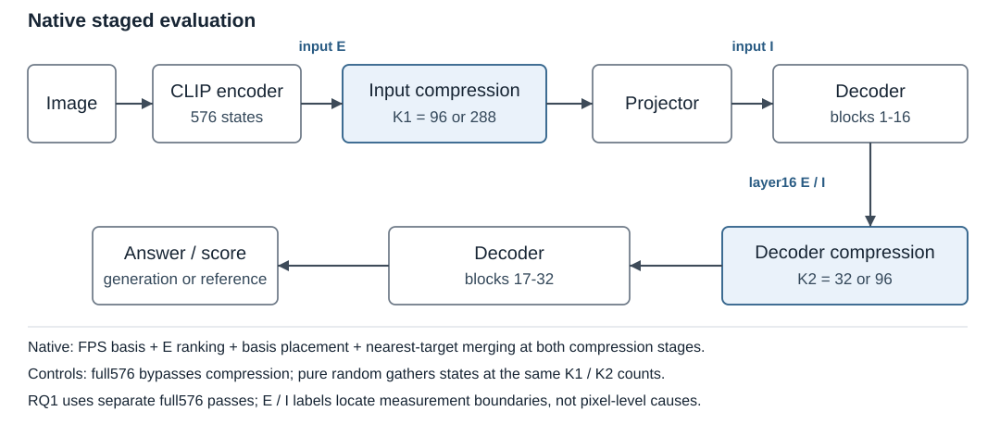

# Understanding Reconstruction-Based Visual Token Compression: When and Why Does ApET Work?

**Midterm Progress Report — Working Draft, October 22, 2026**

**Author:** Peng Chen · CSE590-01 · chen439@cs.stonybrook.edu

## 1. Abstract

This project investigates when reconstruction-based visual token compression preserves a vision-language model's answers. Using native ApET with LLaVA-1.5-7B, we established a reproducible Kaggle workflow and largely completed a bounded diagnostic study of reconstruction error and answer sensitivity. Across 30 selected questions, error rankings do not consistently align with singleton zeroing or IH-inspired retention responses. Substantial RQ2 experiments have also been conducted, including controlled selection/merging diagnostics and larger staged comparisons. On TextVQA100, native ApET scores 41.50% versus a three-seed random-pruning mean of 20.63% at the 96→32 schedule; differences are smaller on GQA and unclear on MMStar. These observations do not yet explain the separate roles of selection, basis representation and merging. Next, we will consolidate component and task-dependent failure analysis before selecting further experiments. No concrete RQ3 improvement has yet been chosen.

## 2. Problem Statement and Goal Recap

Visual-token compression reduces the sequence processed by a vision-language model. ApET [1] uses reconstruction error to select distinctive features and similarity-based merging to aggregate discarded information. However, geometric reconstructability does not directly specify how a representation affects a particular answer. Our proposal therefore asks:

- **RQ1:** How does reconstruction-based visual redundancy relate to task-relevant answer contribution, and how does this relationship change across task types and model layers?
- **RQ2:** How much of ApET's effectiveness comes from reconstruction-error-based token selection, and how much comes from similarity-based token merging?
- **RQ3:** Can the resulting analysis support a lightweight improvement to ApET, such as adaptive compression strength or an alternative reconstruction basis?

The first-half commitments were to:

- Establish native baseline/compressed inference and a reproducible environment on available hardware.
- Prepare the three datasets, baseline predictions and evaluation procedures.
- Instrument reconstruction errors, selections, merge assignments and intervention-based responses at selected depths.

These infrastructure goals have been met. The planned RQ1 diagnostic measurements are largely complete, with qualified conclusions. Many RQ2 conditions have been tested, but interpretation remains ongoing. RQ3 is exploratory: the current evidence has not yet identified a sufficiently justified implementation direction.

## 3. Methods and Implementation to Date

We use the public ApET implementation with native LLaVA-1.5-7B [3], FP16 on Kaggle T4 ×2. A locked Python 3.10.18 environment uses PyTorch 2.1.2+cu121 [7] and Transformers 4.37.2 [8]. Project-owned runners and registered compatibility fixes remain distinguishable from native compression. Inputs, source identities, prompts, predictions and controls are archived; large raw archives stay outside Git, while protocols and compact review materials are tracked.

**Figure 1.** Two-stage evaluation and measurement boundaries. Native compression uses ten FPS basis features, reconstruction-error ranking, basis placement and cosine-nearest merging. The schedules retain K1/K2 = 96/32 or 288/96 states. RQ1 uses separate full576 passes; input E precedes projection, whereas input response interventions follow it.

For RQ1, let p denote the probability of the first tokenizer piece of a frozen reference answer. We compare:

$$
I_i^{\mathrm{zero}}=p_{\mathrm{full}}-p_{\mathrm{zero}\ i},
\qquad
I_i^{\mathrm{retain}}=p_{\mathrm{retain}\ i}-p_{\mathrm{remove\ all}}.
$$

Zeroing replaces one visual vector without shortening the sequence. Retention keeps one visual state relative to removing all visual states at that boundary, preserving nonvisual states and original position IDs. This is a source-informed 1×1 adaptation inspired by Information Horizon [2], not its complete benchmark. The two contrasts use different contexts and sequence geometries; neither is intrinsic token importance or whole-answer accuracy.

RQ2 includes input-only selection × merging controls with native FPS basis representations/placement fixed. A separate larger comparison evaluates full576, native ApET and pure-random pruning at both staged schedules. Pure random uses the same counts and boundaries without FPS, E, basis replacement or merging. Consequently, the latter compares complete procedures rather than isolating error ranking.

## 4. Preliminary Experiments and Results

The RQ1 panel contains 30 reviewed questions over 24 images: GQA12, MMStar12 and TextVQA6 [4–6]. All 576 input positions are examined per question; six questions also have matched after-block16 measurements. Larger RQ2 cohorts are GQA800 development questions on 100 images, full pinned MMStar1500, and TextVQA100 screening/development questions. Nine primary arms per question yield 21,600 predictions over 2,400 question evaluations.

GQA uses normalized short-answer accuracy; MMStar uses the frozen project explicit-choice scorer; TextVQA uses ten-annotator partial-credit consensus scores. Answer preservation rate (APR) conditions on baseline-correct answers; TextVQA APR uses full-credit answers. Baseline-wrong cases remain in aggregate comparisons.

### 4.1. RQ1: reconstruction error and answer sensitivity

**Table 1.** Median per-question Spearman correlations over all 576 positions. These describe the curated panel and should not be treated as population estimates.

| Cohort | E–zeroing | E–retention | Zeroing–retention |
|---|---:|---:|---:|
| GQA12 | −0.087 | −0.068 | −0.016 |
| MMStar12 | +0.009 | −0.121 | −0.005 |
| TextVQA6 | −0.031 | −0.136 | −0.028 |

E does not consistently rank positive reference-answer support under either intervention. Individual E–retention correlations range from −0.486 to +0.404. Filtering and scoring matter: restricting to non-basis positions fully inside the unpadded image changes the GQA median to +0.087.

Six GQA pairs have identical input features/E but between-question retention-map correlations from −0.443 to +0.655. Questions, targets and confidence all change, so this demonstrates conditioned response differences rather than isolating wording. The six-case depth comparison shows no consistent improvement in E–response alignment. Full sweeps also find sparse strong states missed by 32-position calibration: Dominion's best retained first-piece probability is 20.2% at input and 98.1% after block16. These are contextual states and subword scores, not full-answer recovery rates.

Alternative replacement checks and the low zeroing/retention agreement limit a single-ranking interpretation. Late text states have already processed the image, so late visual removal is not question-only inference. Conversely, image positions precede the question under causal attention; deeper native visual E should not be described as attending to that later question.

### 4.2. RQ2: controlled components and broader comparisons

**Table 2.** Correct answers on a separate baseline-correct, failure-enriched 30-case panel at input-only 288 states. Basis representations and placement are fixed; randomization changes ordinary retained positions.

| Retention policy | With merging | Without merging |
|---|---:|---:|
| Native E selection | 19/30 | 21/30 |
| Random ordinary positions, seed101 | 25/30 | 24/30 |
| Random ordinary positions, seed202 | 23/30 | 27/30 |
| Random ordinary positions, seed303 | 26/30 | 26/30 |

Random ordinary retention preserves more correct answers here, but this selected panel is not a representative benchmark. Merging can help or harm depending on the retained set. Routing/protection controls likewise do not establish a general rule; high-E protection rerouted only 21/6,912 incoming assignments, making that negative result largely uninformative about active protection policies.

**Table 3.** Larger staged comparisons: dataset-specific scores (%), random mean ± sample SD over seeds 101/202/303, and native-minus-random differences in percentage points with paired 95% intervals. SD is seed spread, not the paired interval or fresh-native variability. Full576/native have one primary realization per question; no seed SD is assigned to them.

| Cohort | Schedule | Full576 | Native | Pure random, mean ± SD | Native − random [95% interval] |
|---|---|---:|---:|---:|---:|
| TextVQA100 | 96→32 | 49.70 | 41.50 | 20.63 ± 3.12 | +20.87 [13.93, 29.03] |
| TextVQA100 | 288→96 | 49.70 | 44.20 | 34.77 ± 4.80 | +9.43 [3.20, 15.43] |
| GQA800 | 96→32 | 69.00 | 63.75 | 61.29 ± 0.79 | +2.46 [0.25, 4.71] |
| GQA800 | 288→96 | 69.00 | 68.00 | 66.83 ± 0.62 | +1.17 [−0.58, 2.83] |
| MMStar1500 | 96→32 | 34.73 | 33.40 | 33.53 ± 0.53 | −0.13 [−1.35, 1.07] |
| MMStar1500 | 288→96 | 34.73 | 35.00 | 35.20 ± 0.29 | −0.20 [−1.25, 0.85] |

Intervals use 2,000 paired bootstrap draws over image groups, averaging seeds within questions first. They condition on the fixed cohorts, three seeds and captured native realizations. Dataset metrics are not pooled.

In the Brolio case, input-only native merging changes the generated answer to Bottoli. Holding selection fixed, disabling merging or restoring only retained state317's pre-merge value recovers Brolio; sham and count-matched control restoration do not. This supports a conditional merge-related failure, with a post-hoc target and no general protection guarantee.

The main interpretations are:

- **Native gains are heterogeneous.** The evaluated TextVQA cohort shows a substantial native advantage over pure random, particularly at 96→32, while remaining below full576. GQA differences are smaller; MMStar shows no clear aggregate difference. Zero-containing intervals do not establish equivalence.
- **Similar accuracy can conceal changed answers.** MMStar native288→96 loses 36 baseline-correct answers and gains 40, producing APR 485/521 = 93.09% despite a small net accuracy increase.
- **Model competence and evidence demands remain confounded.** MMStar's baseline selects A on 1,059/1,500 questions although only 429 labels are A; 798 questions receive the same wrong parsed option from full576, native288→96 and all three matched random seeds. These describe bias/stability, not proof of visual independence.
- **Attribution remains open.** Tables 2 and 3 change different components, cohorts and schedules. RQ1 response rankings and RQ2 whole-procedure effectiveness answer different questions. Neither establishes a general decomposition of selection, basis handling and merging benefits.

Validity evidence includes no-op/reference checks, exact frozen-feature replays, target/score audits and bounded fresh repeats. Some fresh compressed answers nevertheless vary. The diagnostic and screening cohorts, limited depth coverage and intervention dependence constrain generalization; substantial RQ2 execution does not yet provide a complete mechanism explanation.

## 5. Roadblocks, Risks and Mitigations

Compatibility with changing Kaggle defaults was an initial integration roadblock; the locked native environment now works. Interpretation remains harder: alternative counterfactuals yield different rankings, some compressed realizations vary, and benchmark competence/annotation issues complicate answer-level attribution. Reconstruction residuals and cosine averaging use different criteria; nonlinear decoder behavior makes their relationship an open question, not an established theoretical failure.

Likelihood/impact below are qualitative planning judgments, not measured probabilities.

| Roadblock or risk | Likelihood / impact | Action taken and current status | Contingency |
|---|---|---|---|
| Environment drift | Low / Medium | Locked bootstrap and source records; **Green** | Rebuild the pinned environment in a clean session |
| Response/score and dataset ambiguity | High / High | Audited targets, reviewed cases, compared operators; **Yellow** | Restrict claims to declared scores/cohorts; preserve ambiguous-case flags |
| Fresh-native numerical variation | Medium / Medium | Frozen replays stable; some fresh answers change; cause unresolved; **Yellow** | Preserve first primaries; use targeted repeats if a conclusion depends on instability |
| Incomplete RQ2 attribution; uncertain RQ3 feasibility | High / Medium | Controlled/broad results collected; explanation and extension choice open; **Yellow** | Select one discriminating follow-up; retain a well-controlled negative result as a valid outcome |

## 6. Updated Plan and Milestones

The proposal placed infrastructure/instrumentation in October, main analysis in early–mid November, and an extension later in November. Some main experiments have run earlier, but measurement interpretation and component attribution need more work than a simple correlation study suggested. Extension selection therefore remains conditional. The following are provisional working milestones:

| Target date | Deliverable | Completion criterion |
|---|---|---|
| October 26 | Revised report narrative and method figure | All seven template parts covered; numerical claims traceable |
| October 28–30 | Report PDF and approximately five-slide deck; submission by October 30, 11:59 PM portal deadline | Report meets page limit; deck covers required topics; both submitted |
| November 6 | RQ2 analysis and experiment decision | Document at least two competing explanations and one feasible discriminating comparison, or explain why evidence cannot distinguish them |
| November 13 | Bounded RQ2 follow-up, if feasible | Prespecified matched conditions, complete predictions and controls; report negative or inconclusive findings |
| November 20 | RQ3 feasibility decision | Justify one candidate for implementation, or document why no candidate is sufficiently supported |

A quantified next-phase target is to complete one selected RQ2 comparison at **both staged schedules**, with matched counts and all required structural/replay checks passing. The comparison itself remains to be chosen; no accuracy gain is promised.

Final evaluation will retain dataset-specific scores, APR, paired losses/gains and matched budgets, with three random seeds where applicable. Reserved GQA evaluation remains untouched during method selection. If an RQ3 policy is chosen, compare it with fixed-budget native ApET at comparable average token counts and use independent confirmation; controlled latency/memory measurements will be added only for efficiency claims. Success is reproducible, interpretable evidence addressing the questions, including negative results—not necessarily outperforming ApET.

## 7. References

1. Qiankun Ma et al. **ApET: Approximation-Error Guided Token Compression for Efficient VLMs.** CVPR, 2026. [Paper](https://arxiv.org/abs/2602.19870).
2. Yahong Wang et al. **When Token Pruning is Worse than Random: Understanding Visual Token Information in VLLMs.** CVPR, 2026. [Paper](https://arxiv.org/abs/2512.07580).
3. Haotian Liu et al. **Improved Baselines with Visual Instruction Tuning.** CVPR, 2024. [Paper](https://arxiv.org/abs/2310.03744).
4. Drew A. Hudson and Christopher D. Manning. **GQA: A New Dataset for Real-World Visual Reasoning and Compositional Question Answering.** CVPR, 2019. [Paper](https://arxiv.org/abs/1902.09506).
5. Lin Chen et al. **Are We on the Right Way for Evaluating Large Vision-Language Models?** 2024. [Paper](https://arxiv.org/abs/2403.20330).
6. Amanpreet Singh et al. **Towards VQA Models That Can Read.** CVPR, 2019. [Paper](https://arxiv.org/abs/1904.08920).
7. Adam Paszke et al. **PyTorch: An Imperative Style, High-Performance Deep Learning Library.** NeurIPS, 2019. [Paper](https://arxiv.org/abs/1912.01703).
8. Thomas Wolf et al. **Transformers: State-of-the-Art Natural Language Processing.** EMNLP: System Demonstrations, 2020. [Paper](https://aclanthology.org/2020.emnlp-demos.6/).
