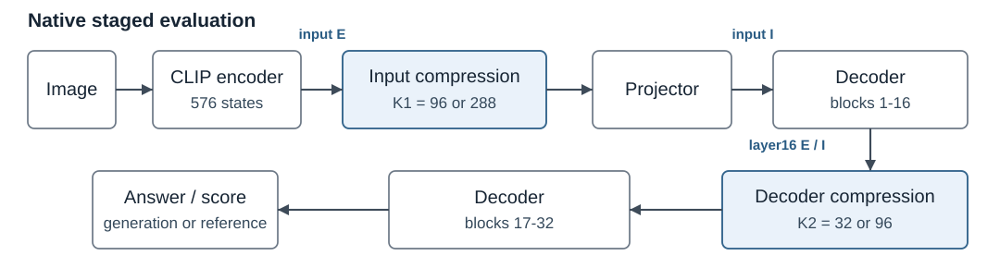

# Understanding Reconstruction-Based Visual Token Compression: When and Why Does ApET Work?

**Midterm Progress Report | October 23, 2026**

**Peng Chen | CSE590-01 | chen439@cs.stonybrook.edu**

## 1. Abstract

This project studies when reconstruction-based visual token compression preserves a vision-language model's answers. We reproduced native ApET inference with LLaVA-1.5-7B and built a reproducible evaluation workflow on Kaggle. The bounded RQ1 investigation is largely complete: across 30 selected questions, reconstruction error does not consistently align with either of our individual-token answer-sensitivity measures. Substantial RQ2 experiments have also been conducted, including component ablations and larger comparisons against random pruning. On TextVQA100, native ApET achieves 41.50% versus a three-seed random mean of 20.63% at the 96-to-32 schedule; its advantage is smaller on GQA and unclear on MMStar. These results do not yet explain how selection, basis preservation and merging contribute separately. The next stage will examine these interactions and compression failures before choosing further experiments. No evidence-supported RQ3 modification has yet been selected.

## 2. Problem Statement and Goal Recap

Images can contribute hundreds of tokens to a vision-language model, increasing inference cost. ApET [1] compresses these tokens without training. It estimates how well each visual feature can be reconstructed from a small basis, retains high-error features, and combines discarded features with similar retained ones. Our concern is that geometric redundancy may differ from what the downstream model needs to answer a question.

The proposal asks three questions:

- **RQ1:** How does reconstruction-based visual redundancy relate to task-relevant answer contribution, and how does this relationship change across task types and model layers?
- **RQ2:** How much of ApET's effectiveness comes from reconstruction-error-based token selection, and how much comes from similarity-based token merging?
- **RQ3:** Can the resulting analysis support a lightweight improvement to ApET, such as adaptive compression strength or an alternative reconstruction basis?

Our first-half commitments, now completed, were:

- Establish native baseline/compressed inference and a reproducible environment.
- Prepare datasets, baseline predictions and scoring.
- Instrument reconstruction errors, selections, merging and answer responses.

RQ1's bounded measurements are largely complete, with qualified interpretation. RQ2 has substantial experimental coverage and unresolved mechanisms. RQ3 remains exploratory; no improvement has been chosen.

## 3. Methods and Implementation to Date

Experiments use native ApET with LLaVA-1.5-7B [3], FP16 on Kaggle T4 x2, and a locked Python 3.10.18 / PyTorch 2.1.2 [7] / Transformers 4.37.2 [8] environment. Project runners, scoring and compatibility fixes are distinguishable from native compression. Raw predictions and source snapshots are archived locally; protocols and compact results are tracked in Git.

**Figure 1.** Starting from 576 states, the schedules retain 96 then 32, or 288 then 96, with second compression after block 16. RQ1 uses separate uncompressed passes: input E precedes projection; input response interventions follow it.

For **RQ1**, we calculate reconstruction error E and compare two answer-response measurements. Both score the first tokenizer piece of a fixed reference answer:

- **Zeroing:** the decrease in its probability when one visual vector is replaced by zero, with the other states present.
- **Retention:** its probability with one visual state retained, minus its probability when all visual states are removed at that boundary.

Retention is a 1x1 adaptation of the Information Horizon idea [2], not its full benchmark. The interventions change different contexts and sequence geometries. Neither gives ground-truth token importance or measures full-answer correctness. We examine all 576 input positions per question and compare six questions at input and after block 16. Late removal retains text states that have already processed the image, so it is not question-only inference.

For **RQ2**, controlled input-only tests vary selection and merging while keeping native basis features and output positions fixed. Larger tests compare uncompressed inference, native staged ApET and pure random pruning at matched counts. Pure random uses no reconstruction ranking, farthest-point-sampled (FPS) basis, basis replacement or merging. This larger comparison evaluates complete procedures, rather than error ranking alone.

## 4. Preliminary Experiments and Results

The RQ1 diagnostic panel has 30 reviewed questions over 24 images: GQA12, MMStar12 and TextVQA6 [4-6]. The larger RQ2 cohorts are GQA800 development questions, full pinned MMStar1500 and TextVQA100 screening/development questions. GQA and MMStar use answer accuracy under frozen project scorers; TextVQA uses ten-annotator partial-credit consensus scores. Answer preservation rate (APR) measures how often a baseline-correct answer remains correct after compression, using full-credit answers for TextVQA. Baseline-wrong cases remain in overall scores.

### RQ1: does error rank answer sensitivity?

**Table 1.** Median per-question Spearman correlation over all 576 positions. Positive correlation would indicate that higher-error states tend to have greater signed response. These are descriptive results for a curated panel.

| Cohort | E vs zeroing | E vs retention | Zeroing vs retention |
|---|---:|---:|---:|
| GQA12 | -0.087 | -0.068 | -0.016 |
| MMStar12 | +0.009 | -0.121 | -0.005 |
| TextVQA6 | -0.031 | -0.136 | -0.028 |

Error does not consistently rank positive answer support under either intervention. Individual E-retention correlations range from -0.486 to +0.404, so the finding is mixed rather than uniformly zero. Scores also depend on filtering and the chosen answer-probability measure. In six GQA same-image pairs, identical input E rankings accompany different question-conditioned response maps; both the question and target answer change. The six-case depth study gives no consistent improvement in E-response agreement after block 16. These observations complete the bounded diagnostic study, not a general theory of task relevance across layers.

### RQ2: when does the complete procedure help?

**Table 2.** Dataset-specific scores (%); random is mean ± sample SD across seeds 101/202/303. The last column gives native-minus-random differences in percentage points and paired 95% bootstrap intervals. Full576 and native use one primary realization per question, so no across-seed SD is assigned to them. Metrics are not pooled across datasets.

| Cohort | Schedule | Full576 | Native | Random mean ± SD | Difference [95% interval] |
|---|---|---:|---:|---:|---:|
| TextVQA100 | 96→32 | 49.70 | 41.50 | 20.63 ± 3.12 | +20.87 [13.93, 29.03] |
| TextVQA100 | 288→96 | 49.70 | 44.20 | 34.77 ± 4.80 | +9.43 [3.20, 15.43] |
| GQA800 | 96→32 | 69.00 | 63.75 | 61.29 ± 0.79 | +2.46 [0.25, 4.71] |
| GQA800 | 288→96 | 69.00 | 68.00 | 66.83 ± 0.62 | +1.17 [-0.58, 2.83] |
| MMStar1500 | 96→32 | 34.73 | 33.40 | 33.53 ± 0.53 | -0.13 [-1.35, 1.07] |
| MMStar1500 | 288→96 | 34.73 | 35.00 | 35.20 ± 0.29 | -0.20 [-1.25, 0.85] |

Intervals use 2,000 paired bootstrap draws over image groups, averaging random seeds within questions first. They condition on these cohorts, three seeds and captured native realizations. Seed SD and paired intervals describe different uncertainty; neither captures all fresh-run numerical variation.

A separate input-only, failure-enriched panel contains 30 baseline-correct questions. At 288 states, native E selection scores 19/30 with merging and 21/30 without. Keeping its ten FPS basis representations and slots, random ordinary retention scores 23-26/30 with merging and 24-27/30 without across the three seeds. Merging's effect changes with the selected set. This panel does not establish a population ranking or a general benefit from disabling merging.

One exact-text case illustrates a local failure: native input compression changes the wine brand **Brolio** to **Bottoli**. Restoring one retained state's pre-merge value recovers Brolio, while sham and matched-control restoration do not. This is a conditional rescue for a post-hoc selected state, not a general protection rule.

The main takeaways are:

- **Native ApET helps relative to random in some settings.** Its advantage is clearest on TextVQA100, especially at 96→32, while remaining below uncompressed inference. GQA differences are smaller; MMStar differences are unclear. An interval containing zero does not establish equivalence.
- **Aggregate accuracy can hide failures.** At MMStar 288→96, native loses 36 baseline-correct answers and gains 40; APR is 93.09%. Model competence also limits interpretation: the baseline predicts A on 70.6% of questions, although only 28.6% of gold labels are A. This does not prove image independence.
- **RQ1 and RQ2 answer different questions.** Weak agreement with singleton response rankings does not contradict useful whole-procedure compression. Collective information, basis preservation and merging are possible contributors, but we have not separated them fully.

Validity checks include target/scoring audits, no-op checks and exact frozen-feature replays. Bounded fresh repeats nevertheless expose some changed compressed answers. The curated and screening cohorts, limited depths and intervention definitions remain important limits on interpretation.

## 5. Roadblocks, Risks and Mitigations

The locked environment largely resolves Kaggle integration. Scientific limits remain: interventions use different baselines, and fresh-run variability has no established cause. Linear reconstructability and cosine averaging also differ; their downstream effects remain unexplained. We have not tested an attention-preserving merging theory.

Likelihood and impact below are qualitative planning judgments, not measured probabilities.

| Risk | Likelihood / impact | Status and action | Contingency |
|---|---|---|---|
| Environment drift | Low / Medium | Green: pinned setup works | Rebuild the locked environment |
| Response-score ambiguity | High / High | Yellow: audit targets and compare operators | Limit claims to defined measures and cohorts |
| Fresh-run variation | Medium / Medium | Yellow: fixed replay stable; fresh changes recorded | Preserve first primaries; repeat only claim-critical cases |
| Incomplete attribution / RQ3 feasibility | High / Medium | Yellow: component evidence collected; direction open | Choose one discriminating test; retain informative negative results |

## 6. Updated Plan and Milestones

Main experiments ran earlier than November's plan, but interpreting component effects requires further work. RQ3 selection remains conditional. These are proposed milestones, not completed work.

| Target | Deliverable and completion criterion |
|---|---|
| Oct 30, 11:59 PM | Submit the 3-4-page report PDF and approximately five-slide deck, covering the required topics |
| Nov 6 | Document at least two competing RQ2 explanations and select one feasible matched comparison, or state why existing evidence cannot distinguish them |
| Nov 13 | Complete the selected bounded comparison, if feasible, with all predictions, APR, uncertainty and validity checks recorded |
| Nov 20 | Make an RQ3 go/no-go decision: justify one candidate or document why no modification is sufficiently supported |
| Dec 15 (syllabus; tentative) | Final presentation and report/code submission, after freezing the evidence and essential verification |

One quantified next-phase criterion is a prespecified RQ2 comparison at **both staged schedules**, with matched counts and required replay/structural checks passing. The exact comparison remains to be chosen. Final evaluation will retain dataset scores, APR and paired losses/gains, with three random seeds where applicable. Reserved GQA evaluation remains untouched during selection. If an RQ3 policy is chosen, compare it with fixed-budget native ApET at comparable average token counts and seek independent confirmation. Controlled timing is needed before making speedup claims. Success means reproducible, interpretable evidence; an informative negative result is acceptable, and no accuracy improvement is promised.

## 7. References

1. Q. Ma et al. [**ApET: Approximation-Error Guided Token Compression for Efficient VLMs.**](https://arxiv.org/abs/2602.19870) CVPR, 2026.
2. Y. Wang et al. [**When Token Pruning is Worse than Random: Understanding Visual Token Information in VLLMs.**](https://arxiv.org/abs/2512.07580) CVPR, 2026.
3. H. Liu et al. [**Improved Baselines with Visual Instruction Tuning.**](https://arxiv.org/abs/2310.03744) CVPR, 2024.
4. D. A. Hudson and C. D. Manning. [**GQA: A New Dataset for Real-World Visual Reasoning and Compositional Question Answering.**](https://arxiv.org/abs/1902.09506) CVPR, 2019.
5. L. Chen et al. [**Are We on the Right Way for Evaluating Large Vision-Language Models?**](https://arxiv.org/abs/2403.20330) 2024.
6. A. Singh et al. [**Towards VQA Models That Can Read.**](https://arxiv.org/abs/1904.08920) CVPR, 2019.
7. A. Paszke et al. [**PyTorch: An Imperative Style, High-Performance Deep Learning Library.**](https://arxiv.org/abs/1912.01703) NeurIPS, 2019.
8. T. Wolf et al. [**Transformers: State-of-the-Art Natural Language Processing.**](https://aclanthology.org/2020.emnlp-demos.6/) EMNLP: System Demonstrations, 2020.
